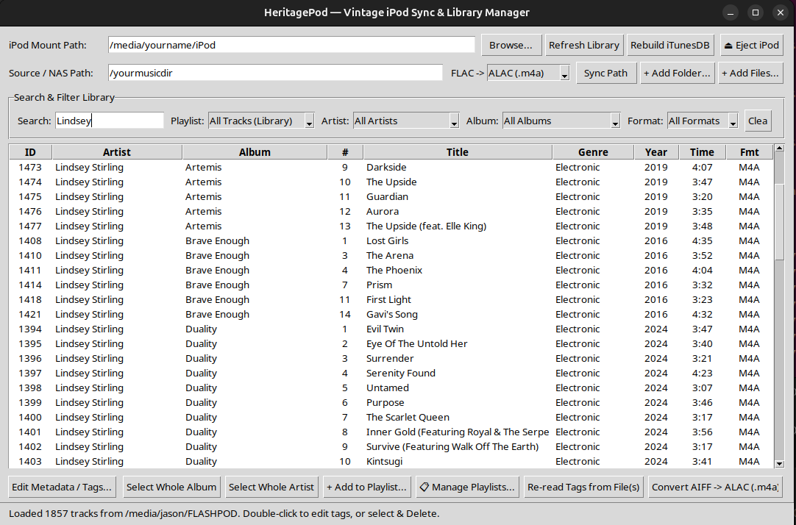

# HeritagePod 🎵

**A lightweight, dedicated Linux companion for vintage iPod Classics (1st–4th Gen, stock Apple OS).**

HeritagePod bridges modern lossless music collections and audiobooks directly to vintage iPod hardware without iTunes, virtual machines, or bloated music players.



Note: Currently only tested with a 3rd Gen.
---

## ✨ Features

* **Lossless Audio Sync (FLAC $\rightarrow$ ALAC / AIFF):**
  * Point HeritagePod at any folder or network share (local drive or NAS/Samba).
  * Automatically encodes FLAC into hardware-optimized Apple Lossless (`.m4a`) or uncompressed AIFF (`.aif`) on the fly **in RAM** to avoid duplicate files and IO churn.
  * Formats audio files with 4 KB atom alignment and `+faststart` moov-headers, preventing the notorious 5-second buffer crash on flash-modded (iFlash/CF) vintage iPods.

* **Native Audiobooks with Position Bookmarking:**
  * Packages audiobooks into native `.m4b` containers so they appear in the iPod's dedicated top-level **Audiobooks** menu.
  * Enables resume-position bookmarking and variable playback speed.
  * Includes 1-click chapter title prefixing (e.g. `Project Hail Mary - 01`, `02`...) so multi-part audiobooks cluster cleanly in the 3G's flat audiobooks menu.

* **Built-in Playlist Manager:**
  * Create, rename, and delete playlists directly from the app.
  * Reorder tracks up/down with `▲ Up` and `▼ Down` controls to set exact custom playback sequences.
  * Right-click any track or album in the library to instantly add it to a playlist.
  * Filter the main library table by playlist to review contents at a glance.

* **Batch Metadata & Tag Editor:**
  * Edit single tracks or batch-edit entire albums (Artist, Album, Genre, Year, Track/Disc numbers).
  * Auto-number tracks sequentially in table order.
  * Clean up messy track titles (e.g., stripping leading numbers like `01 - Track` $\rightarrow$ `Track`).
  * Re-read embedded file tags directly from audio files anytime.

* **Zero PIP Dependencies:**
  * Written in 100% pure Python standard library (including the binary `iTunesDB` serializer, MP4 atom parser/muxer, and Tkinter GUI).
  * Requires no virtual environments or `pip install` commands.

* **Safe 1-Click Hardware Eject:**
  * An integrated **⏏ Eject iPod** button flushes all filesystem buffers and signals the device, safely transitioning the iPod screen to *"OK to disconnect"*.

---

## ⚙️ Requirements

* **Python 3.8+** with `python3-tk` (included by default on most Linux distributions)
* **`ffmpeg`** (used for audio transcoding)

No third-party Python packages (`pip`) are required.

---

## 🚀 Quick Start

### 1. Launch the GUI
```bash
python3 heritagepod.py
```
*(Or specify the mount directory directly: `python3 heritagepod.py --ipod /media/$USER/IPOD`)*

### 2. Command Line Usage (Optional)
HeritagePod also provides a full CLI interface for terminal workflows:

* **Sync music files or album folders:**
  ```bash
  python3 heritagepod.py add /path/to/album/
  ```
* **Convert existing AIFF tracks on the iPod to ALAC in-place (saving ~50% space):**
  ```bash
  python3 heritagepod.py convert-alac
  ```
* **Transcode MP3 audiobooks on the iPod to native AAC `.m4b`:**
  ```bash
  python3 heritagepod.py convert-audiobook
  ```
* **Rebuild `iTunesDB` instantly from the on-device manifest:**
  ```bash
  python3 heritagepod.py rebuild
  ```
* **Safely eject the iPod:**
  ```bash
  python3 heritagepod.py eject
  ```
  
---

## 📄 License
MIT License. Free to use, modify, and distribute.
